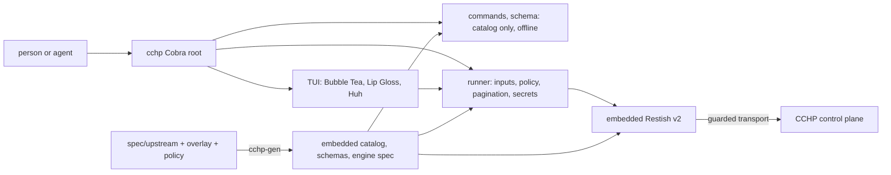

# How cchp is built

## Parts

- **`cmd/cchp`** starts `internal/cli`, the Cobra root cchp owns: `login`,
  `status`, `commands`, `schema`, `api`, `guide`, `skill`, `version`, and one
  command group per area (`providers`, `keys`, `usage`, …).
- **`internal/catalog`** describes operations, parameters, policy and coverage.
  **`internal/assets`** embeds the generated catalog, schemas and engine spec,
  so discovery and help need no network and no spec parsing at start-up.
- **`internal/runner`** runs one operation for both the CLI and the TUI: it
  checks inputs and the JSON body against the schema, applies the policy,
  resolves credentials, calls the engine, walks pages, moves secrets to
  `--secret-out` and maps failures to plain-language errors.
- **`internal/engine`** embeds Restish v2 through its supported embedding API:
  a branded CLI with bundled configuration and the operation promoted to the
  root, a custom auth handler that attaches the management token for the bound
  origin only, a JSON content type that sends bodies byte for byte, and a
  capture formatter that hands the response back to cchp. Restish loads the
  generated engine spec from a local file, never by discovery. A guard on the
  standard library transport Restish clones refuses credentials to other
  origins and stops dry runs before any connection.
- **`internal/tui`** is the home screen and sign-in form.
- **`internal/auth`** stores the token (keychain or a mode-600 file) and binds
  it to the server origin.
- **`internal/redact`** is the one redaction policy.
- **`skills/`** and **`guides/`** are embedded and printed or installed by
  `cchp skill` and `cchp guide`.

## Tests

- Unit tests cover the policy, redaction, the output contract, body
  preservation, the origin and redirect guard, the spec lock and the TUI
  (golden screens with `teatest`).
- End-to-end tests (`go test -tags e2e ./test/e2e/`) run the built binary
  against a real CCHP server started with `scripts/e2e/up.sh`.
