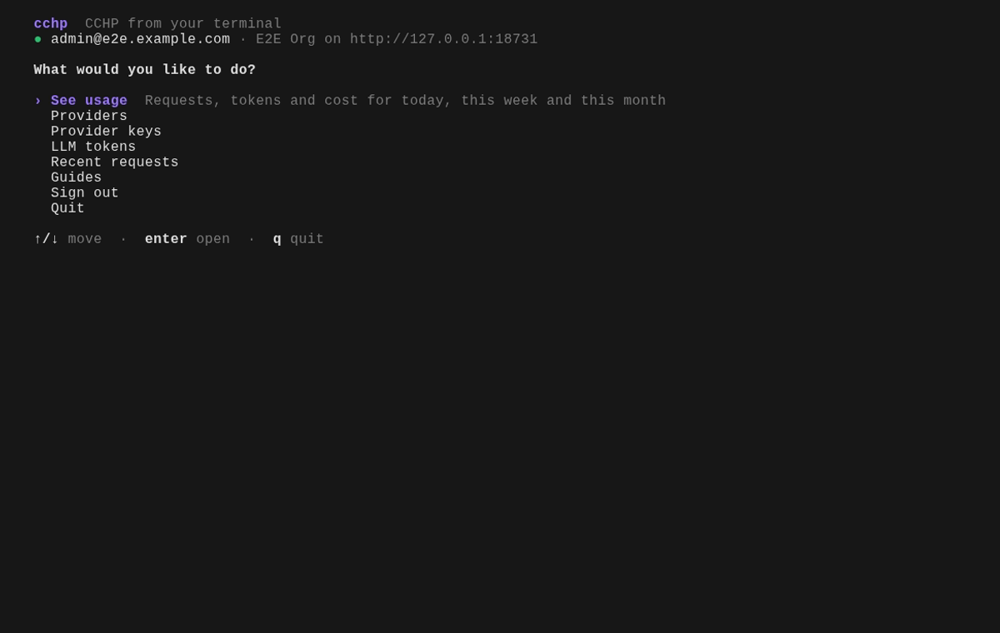
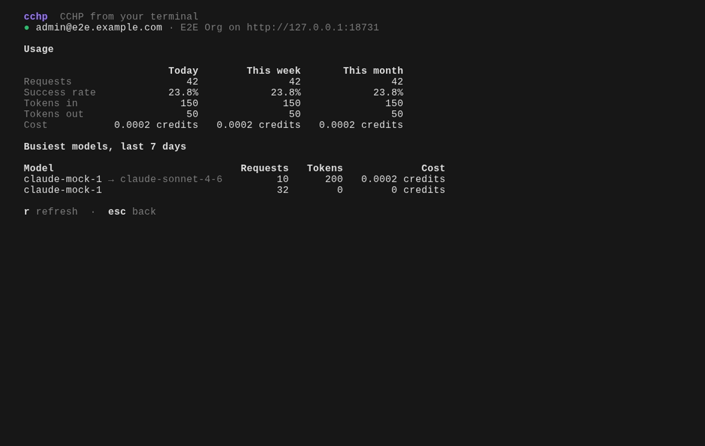

# Guide for people

## The home screen

Run `cchp` in a terminal. Move with the arrow keys and press Enter.



| Task | What you see |
| --- | --- |
| See usage | Requests, success rate, tokens and cost for today, this week and this month, and the busiest models |
| Providers | Your upstream providers; press `/` to search, Enter for details |
| Provider keys | Pick a provider, then see its keys |
| LLM tokens | The keys your apps use to call models |
| Recent requests | The latest calls through the gateway; Enter shows one request |
| Guides | Short how-tos |

Details show the most useful fields first; press `a` for every field. `Esc`
goes back, `q` leaves.



## Signing in

```sh
cchp login
```

cchp asks for two things:

1. **Server address.** `https://` is already filled in. cchp checks the address
   as you type.
2. **Management token.** Paste it; the screen hides it.

cchp checks the token with the server before saving it, then shows who you are
signed in as. `cchp status` shows it again later, and `cchp logout` removes the
token from this computer.


## Commands

Everything on the home screen, and much more, is a command. Commands come in
groups:

```sh
cchp usage summary
cchp providers list
cchp keys list <provider-id>
cchp llm-tokens list
cchp requests list --limit 20
cchp requests get <request-id>
```

`cchp --help` lists the groups, `cchp <group> --help` lists a group's commands,
and `cchp commands --search "<words>"` finds a command by what it does.


## Changes and confirmations

Commands that add or change things run straight away. Commands that delete or
replace something, or that create a secret shown only once, ask first and
explain why, with **Go ahead** and **Cancel** to choose from.

Secrets such as a new LLM token appear once. Save them with `--secret-out
<file>`, or copy them from the screen straight away.

## When something goes wrong

cchp says what happened in plain words and what to do next. The request ID in
small print helps an administrator find the request on the server.


| Message | What to do |
| --- | --- |
| Your token can't do this. Ask an admin for the X permission. | Ask for a token that includes that permission. |
| This server needs you to sign in from the browser for this action. | Use the CCHP console for it. |
| This server needs you to complete a human check in the browser for this action. | Use the CCHP console for it. |
| The server didn't accept your token. | Create a new token and run `cchp login`. |

`cchp guide errors` lists every message.

## Colors

cchp uses your terminal's own colors, so it reads well on light and dark
backgrounds. Set `NO_COLOR=1` to turn color off.
